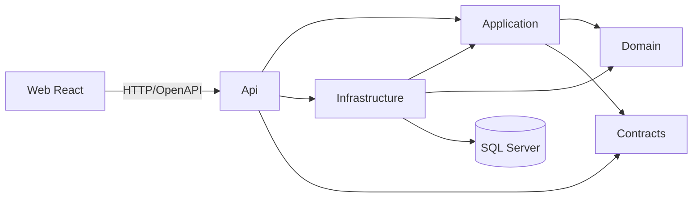

# Arquitectura objetivo KDI

Estado: diseño propuesto; ADR pendientes de aceptación. Modular Monolith sobre .NET 10/ASP.NET Core/C#, SQL Server y EF Core; React/TypeScript/Vite como aplicación web. Dapper solo para consultas justificadas mediante evidencia y ADR. No se instala ni genera código en Etapa 1.

## Despliegue y capas

Un backend desplegable y un frontend; SQL Server como persistencia transaccional. Clean Architecture pragmática: Domain sin infraestructura; Application coordina casos de uso y puertos; Contracts contiene DTO/eventos públicos pequeños y versionados; Infrastructure implementa persistencia/adaptadores; Api compone dependencias y HTTP; Web consume HTTP y no referencia ensamblados del servidor.

Las flechas expresan dependencia permitida; Api→Infrastructure se limita a composición. Domain y Contracts no dependen entre sí. Contracts no es un depósito de entidades EF o servicios. No imponer mediador, repositorio genérico, bus o CQRS como dependencias obligatorias.

## Modularidad pragmática

Los seis proyectos iniciales son capas, no bounded contexts. Dentro de cada capa se organizan carpetas por los módulos de [MODULES.md](MODULES.md). Cada módulo posee sus reglas y datos; no usar navegación EF entre módulos ni DbContext de otro módulo. En esta fundación la separación por carpetas no impide por sí sola referencias indebidas: agregar comprobación de dependencias y revisión; extraer ensamblados por módulo solo si el crecimiento lo justifica mediante ADR.

Llamadas entre módulos por fachadas de Application y contratos públicos. Eventos para efectos posteriores; no usar eventos para ocultar validación sincrónica imprescindible. El grafo de dependencias de negocio es acíclico. El host puede componer todos los módulos sin convertir esa composición en dependencia de dominio.

La regla de archivo de cliente requiere consultar proyectos. Para evitar un ciclo Organizations→Portfolio→Organizations, el caso transversal `ClientLifecycle` se ubica en `Application/Coordination`, por encima de ambos módulos, y consume sus fachadas públicas. El endpoint de archivo llama esa coordinación; Organizations no importa Portfolio. La operación de archivo protegida no se expone como atajo que omita la comprobación. Infrastructure implementa la atomicidad mediante el puerto de coordinación acordado en ADR-003. Este coordinador de negocio pertenece a KDI y no es un motor de agentes.

## Persistencia y consistencia

Propuesta: una DB SQL Server, esquemas por módulo, DbContext y migraciones con propiedad e historial diferenciados. Transacción local por comando/módulo. Para crear un proyecto, validar que el cliente pertenece a la organización y está activo. Evitar carrera con archivo de cliente mediante operación de coordinación transaccional explícita en Infrastructure, con locks/aislamiento y orden de acceso definidos; la estrategia exacta y su prueba se deciden en ADR-003 antes de implementar. No afirmar integridad solo por una comprobación previa en Application.

Identificadores estables, OrgId explícito en recursos, concurrencia optimista y auditoría. FKs e índices intra-módulo; restricciones entre módulos solo si se documenta propiedad y evolución. Reporting construye proyecciones sin convertirse en dependencia de los módulos fuente. Entrega eventual usa outbox solo cuando existan efectos asíncronos necesarios; no agregar broker en el primer incremento.

## Identidad y API

Propuesta OIDC con proveedor a decidir, políticas por permiso y recurso; RBAC más alcance. Resolver organización desde contexto autenticado y validar pertenencia, sin confiar en encabezado/route por sí solo. Authorization denegada por defecto, pruebas de acceso horizontal y vertical. Flujo browser, cookies/tokens, CSRF, CORS y manejo de sesiones requieren ADR específico.

OpenAPI documenta endpoints, autenticación, paginación, errores y concurrencia. Validaciones de entrada y negocio diferenciadas; errores sin detalles sensibles. TLS, secretos y operación se definen por ambiente, sin credenciales en repositorio.

## Calidad y entrega

Unitarias, integración SQL Server, API con host de prueba y E2E UI/API/DB aisladas. Pipeline propuesto: restore autorizado → build → pruebas/lint/typecheck → contrato API → escaneo pertinente → artefacto versionado. Aplicación de migraciones y despliegues por etapas aprobadas; no migrar automáticamente al arrancar producción. Observabilidad con correlación, métricas y logs redactados. Ver ADR y plan de pruebas.
